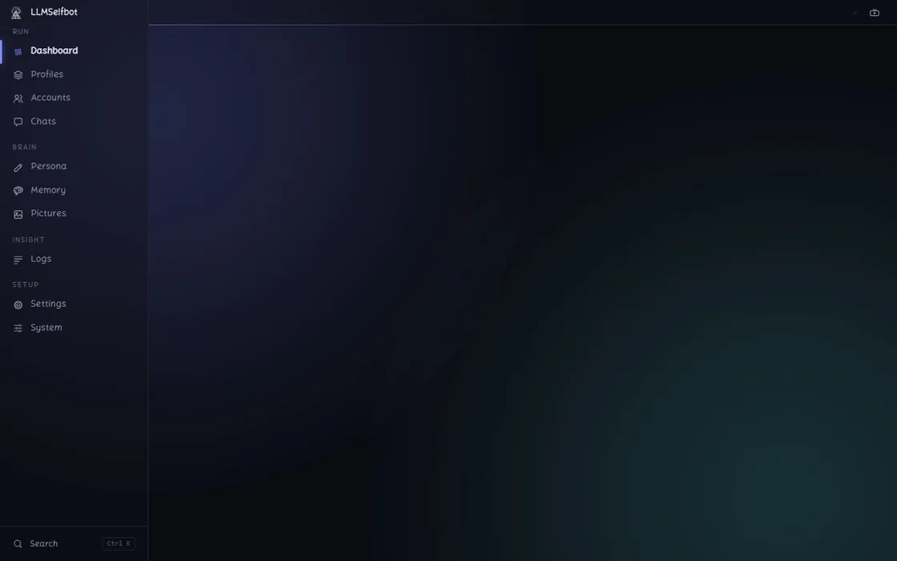
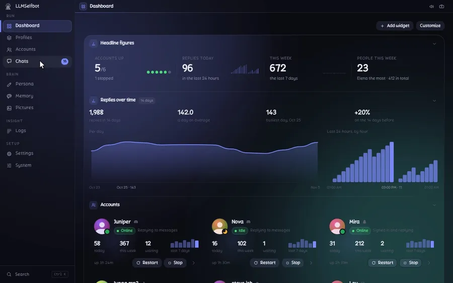
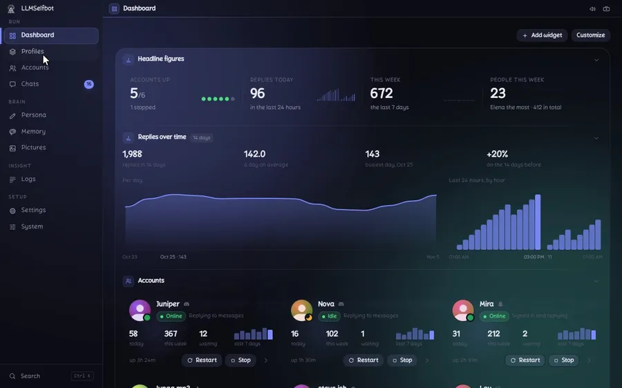
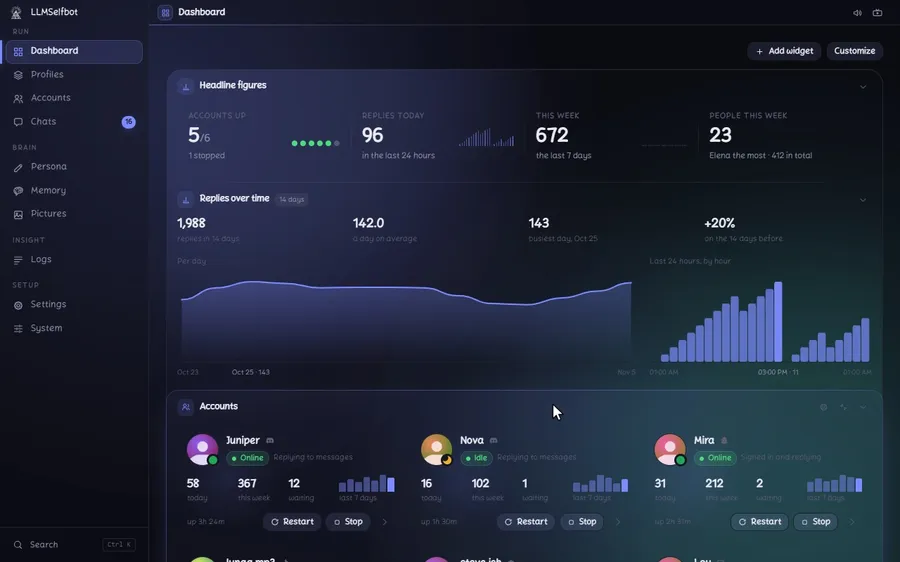
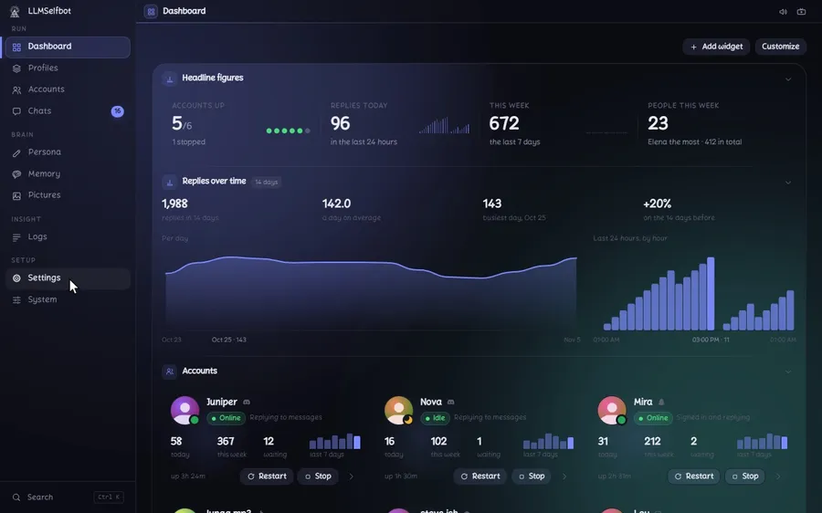
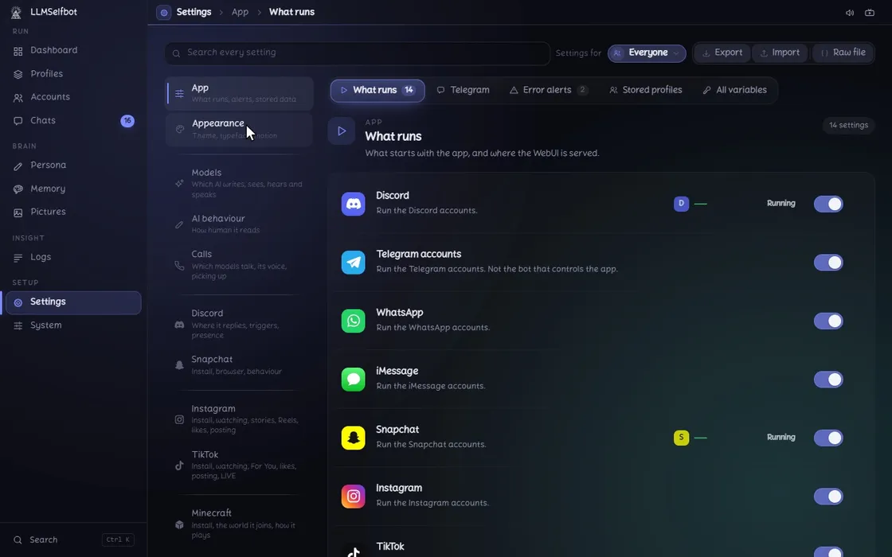
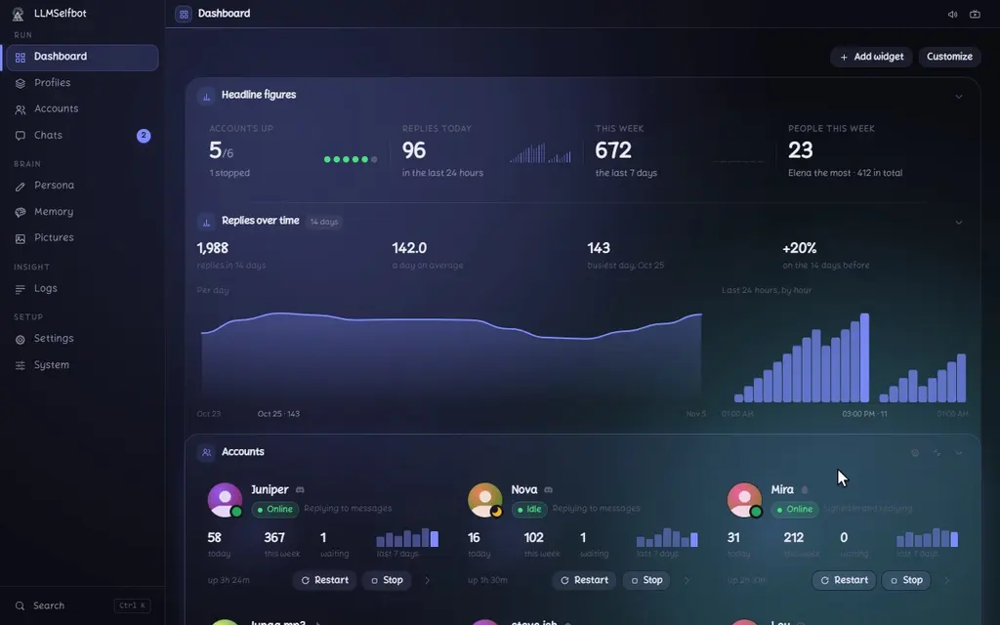
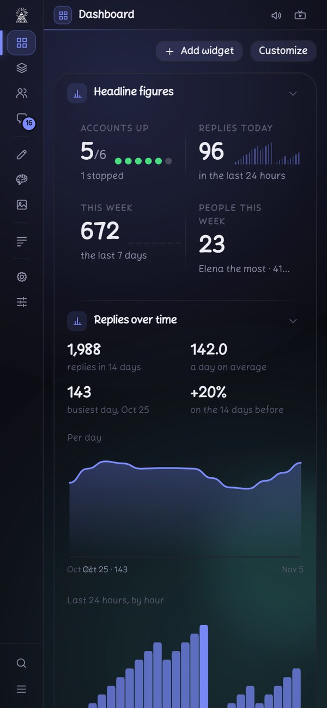

<div align="center">


# LLMSelfbot

**An AI that answers your messages for you, and texts like a real person while it's at it.**

Give it a personality, add your accounts and leave it running.<br>
It's free with a Groq key, and it's one download.

[](https://github.com/miiazertyy/LLM-Selfbot/releases/latest)
[](https://github.com/miiazertyy/LLM-Selfbot/actions/workflows/build-exe.yml)
[](LICENSE)




[Platforms](#platforms) · [What it does](#what-it-does) · [The app](#the-app) · [Setup](#setup) · [Local AI](#running-the-ai-on-your-own-computer) · [Community](#community-profiles) · [Building it](#building-it-yourself)

</div>

<br>

> [!WARNING]
> Selfbots break the rules of every platform below, and accounts do get banned for it. Only run it on an account you're
> fine losing. **Careful mode** (Settings › AI behaviour) is there for new accounts: it replies less, waits longer, and
> does nothing public until a date you pick.

## Platforms

One personality and one memory across all of them. You add accounts in **Accounts**, and each platform has its own tab
in **Settings**.

| Platform | How it connects | What it does there | Runs on |
|---|---|---|---|
| **Discord** | its own API | DMs, group chats, servers, friend requests, statuses, voice channels | computers, Android |
| **Snapchat** | a Chrome window | chats, snaps of itself, friend requests | computers |
| **TikTok** | a Chrome window | DMs, message requests, the videos people send, comments, LIVE, For You, posting | computers |
| **Instagram** | a Chrome window | DMs, message requests, stories, reels, comments, Notes, posting | computers |
| **X** <sup>beta</sup> | a Chrome window | DMs, replies, likes, posting | computers |
| **Reddit** <sup>beta</sup> | a Chrome window | chats, inbox, comments, votes, posting | computers |
| **WhatsApp** <sup>beta</sup> | linked from your phone, no browser | chats, groups, statuses | computers |
| **Telegram** | your own account | chats, groups, channels | computers, phones |
| **iMessage** | a Mac running BlueBubbles, or your iPhone | texts and group chats | computers |
| **Minecraft** | joins a server as a player | plays, and chats with people in game | computers |

The ones in a Chrome window need [Node.js](https://nodejs.org/en/download). The app gets the rest the first time you set
one up, and they all share that install. Beta means it hasn't run on many real accounts yet.

<details>
<summary><b>Good to know, per platform</b></summary>

<br>

- **Discord.** Sign in, or paste your token. To find it: open Discord in your browser, press `Ctrl+Shift+I`
  (`Cmd+Opt+I` on a Mac), open the **Network** tab, send a message, click the request called `messages`, and copy the
  `Authorization` value under **Request Headers**. Anyone with it is logged in as you, so keep it to yourself.
- **Snapchat.** The first login needs the window visible. After that it can run hidden. It only opens unread chats, and
  Snapchat's website shows about twenty at a time. Camera snaps can't be read, photos in a chat can.
- **TikTok, Instagram, X and Reddit.** A window opens and you sign in yourself, however you like. Everything public
  (likes, comments, posts, follows) is off until you turn it on, and each has a daily limit. They start slow: 20 messages
  an hour at most on TikTok and Instagram, 12 on X and Reddit. They can only do what their website can, so no calls on
  TikTok and no going live on Instagram.
- **WhatsApp.** You link it from your phone, like WhatsApp Web. It can't pick up a call, so it declines it and texts back.
- **Telegram.** It signs in as your own account, not as a bot.
- **iMessage.** Either through BlueBubbles Server on a Mac, or an iPhone that passes messages along with a Shortcuts
  automation.
- **Minecraft.** It joins as a player, plays, and talks to people in the chat. Offline servers only need a name, a
  Microsoft account signs in once with a code.
- **Phones** run Discord (one account at a time, Android only for now) and Telegram. Linux on ARM needs Chromium installed
  for the Chrome window ones.

Adding a platform? Start with [docs/ADDING_A_PLATFORM.md](docs/ADDING_A_PLATFORM.md).

</details>

## What it does

You write a character: a name, an age, where they live, how they text, what they're into. Add your accounts and it
answers everyone as that character.

Getting an AI to write a reply is the easy part. Making it feel like you're texting a person is the hard part, and
that's most of this project:

- It waits for people to finish double texting, then answers everything at once
- It isn't always around. Replies come after a random wait, some never come, and it goes offline at night in its own timezone
- It types at a real speed, sends a few short texts instead of one paragraph, and fixes the odd typo a second later
- It remembers people: names, plans, what they said last week. You can read and edit all of it
- Its mood drifts through the day, and when it answers hours late it opens with an excuse that makes sense
- It answers in whatever language you write in, and sometimes it just reacts with an emoji
- It reads pictures, GIFs, links and voice messages, watches the videos people send, and sends selfies, videos and voice
  messages back

<details>
<summary><b>And the smaller stuff</b></summary>

<br>

- A selfie can get a caption, the time, a few emoji or a filter, on the accounts you allow
- Videos are converted for you, and made smaller when they're too big to send
- It reads people's profiles (name, status, bio) for context
- It knows a DM from a group chat, a mention and a reply
- It accepts friend requests after a believable wait, or right away from the app
- It texts people who went quiet for a few days
- It never sends two replies at once, and cools down per person
- It changes its status on a schedule
- When a key or a model hits its limit, the next one takes over
- You can also run it from Telegram, with a bot of your own

</details>

## The app

Everything happens in the app. You never type commands into a chat, and you never have to open a config file (you
still can).

<table>
<tr>
<td width="50%"></td>
<td width="50%"></td>
</tr>
<tr>
<td><b>Chats</b><br>Who's waiting on a reply, and when it goes out. Answer one now, or let it take its time.</td>
<td><b>Profiles</b><br>Run more than one bot. Each has its own persona, pictures, memory and settings, on the accounts you give it.</td>
</tr>
<tr>
<td></td>
<td></td>
</tr>
<tr>
<td><b>Memory</b><br>What it knows about each person. Fix what it got wrong, add what it missed.</td>
<td><b>Models</b><br>Which AI writes the replies, and which one takes over when it's busy. Drag them into the order you want.</td>
</tr>
</table>

| Page | What's on it |
|---|---|
| **Dashboard** | Is it running, replies today, charts and the live log. Drag the sections around |
| **Profiles** | Every bot you run and its accounts. Make one, copy one, or get one from **Community** |
| **Accounts** | Add accounts, start, stop or pause them, and pick each one's profile |
| **Chats** | Who's waiting on a reply. Answer one or all of them now, and accept friend requests |
| **Persona** | Who a profile is, its moods and how it reacts |
| **Memory** | What it knows about everyone |
| **Pictures** | The selfies and videos it can send, and their filters |
| **Logs** | Everything the accounts print, filtered however you want |
| **Settings** | Every option, grouped by what it's for |
| **System** | What's missing, backups, updates, and a QR code to open the app on your phone |

Every page has its own little entrance, and every button makes a sound. Both can be turned off.

### Make it yours



Six themes, four backgrounds, three panel styles and a few typefaces, or upload your own font.

### Big Picture Mode



A full screen view to leave open on a second monitor. When a reply is being written, that conversation takes over the
screen in the colours of their profile. The rest of the time it walks through its own pages: who it's talking to, your
accounts, today's numbers, its persona and pictures. Anything on it can be pressed, with the mouse, the arrow keys or a
gamepad.

**Ctrl+Shift+B** opens it and **Esc** leaves.

### On your phone



The app is a web page it serves to itself, so anything with a browser can open it. **System** shows the address and a
QR code. Scan it and you've got the whole app on your phone, pause button included.

At first only your own computer can open it. Letting other devices in is one switch on that same page. Only turn it on
at home, since the app holds your logins.

The window can also shrink down to a small panel in a corner of your screen.

<br clear="right">

## Setup

**1. Download it** from the [latest release](https://github.com/miiazertyy/LLM-Selfbot/releases/latest). Python and
everything else is inside.

| You're on | Get | Then |
|---|---|---|
| Windows | `LLMSelfbotSetup.exe` | Run it. You get a Start menu shortcut and an uninstaller |
| Windows, no install | `LLMSelfbot-portable.exe` | Run it. It opens a bit slower, since it unpacks itself every time |
| Linux | `LLMSelfbot-linux-x86_64` | `chmod +x` it and run it |
| Linux on ARM (Raspberry Pi and so on) | `LLMSelfbot-linux-aarch64` | Same |
| macOS | `LLMSelfbot-macos-arm64` | Same |
| Android | `LLMSelfbot-android.apk` | Open it on the phone and allow the install |
| iPhone | `LLMSelfbot-ios.ipa` | Install it with [AltStore](https://altstore.io) or [SideStore](https://sidestore.io) |

Windows gets its own window. On Linux and macOS it prints an address to open in your browser, which is handy on a server
or a Pi. The phone apps run everything on the phone itself.

**2. Get an AI key.** [Groq](https://console.groq.com/keys) is free and fast, so it's the default. Add a few keys and it
moves to the next one whenever one hits a limit. OpenAI, Anthropic, Gemini, OpenRouter, Mistral, DeepSeek, xAI,
Together and Cerebras work too, and you can mix them. For voice there's also ElevenLabs, Deepgram, Cartesia, Fish
Audio, Rime and MiniMax.

**3. Paste the key** in **Settings › Models › Providers**.

**4. Add an account** in **Accounts** and start it. Its card says what it needs, and [Platforms](#platforms) has the
rest. That's it.

<details>
<summary><b>What works where</b></summary>

<br>

Which platforms run where is in the [Platforms](#platforms) table. The rest:

| | Windows | Linux, macOS | Linux on ARM | Android | iPhone |
|---|---|---|---|---|---|
| A proxy for each account | yes | yes | yes | yes | yes |
| Voice messages | yes | with ffmpeg | with ffmpeg | no | no |
| Try a call | yes | yes | yes | yes | yes |
| A voice that runs on your computer | yes | yes | 64-bit only | no | no |
| Picking files (pictures, exports, backups) | yes | yes | yes | yes | yes |
| Starting local AI servers | yes | yes | yes | no, use one on your network | no, use one on your network |
| Updating itself | yes | yes | yes | downloads the new APK | reinstall the IPA |

If something can't work on your device, the app says so next to it, and **System** lists them all. Phones also stop apps
that aren't on screen, so keep the app open while it replies.

</details>

## Running the AI on your own computer

If you'd rather nothing leave your computer, **Settings › Models › This computer** finds the AI server you run
([Ollama](https://ollama.com/download), [LM Studio](https://lmstudio.ai), [Jan](https://jan.ai),
[GPT4All](https://www.nomic.ai/gpt4all), [KoboldCpp](https://github.com/LostRuins/koboldcpp), llama.cpp, LocalAI, vLLM
and a few more), lists its models and starts it with the app. With Ollama and llama.cpp it can also download models,
Hugging Face ones included. Anything else that speaks the OpenAI API works if you type its address.

Replies, reading pictures, hearing and speaking each move on their own. Move all four and you don't need a key at all.
For hearing and speaking, **Settings › Calls** can fetch a voice that runs on your computer (about 250 MB, once).

> [!NOTE]
> If your local server stops, replies stop too. They never quietly go back to the internet, since keeping things off it
> was the whole point.

## Community profiles

**Profiles › Community** has profiles other people shared. Open one to see everything it comes with, then add it. When
its author sends an update, you can take it or leave it.

Only how it talks is shared: the persona, its moods and style, its face, and the pictures its author picked. Never
memory, chats, accounts, models or keys.

To share yours, pick **Share to community** on its card, sign in with GitHub once, check what goes public, and send.
It's live a few minutes later if it passes the checks. It all lives in this repo, with no server of its own:
[how it works](community/README.md). What you send is public, and GitHub shows which account sent it.

## Where your stuff is saved

Everything lives in `%APPDATA%\LLMSelfbot`. Updating or reinstalling never touches it.

| | |
|---|---|
| `config/config.yaml` | every option |
| `config/.env` | logins and API keys |
| `config/instructions.txt` | the first profile's persona |
| `config/personas/` | every profile: its persona, pictures, settings and face |
| `config/bot_data.db` | memory, stats, picture descriptions |
| `config/pictures/` | the first profile's selfies and videos |

**System › Download backup** zips all of it. Want it next to the exe instead? Make a folder called `portable` beside it.

## Building it yourself

You don't need any of this to use the app.

```bash
git clone https://github.com/miiazertyy/LLM-Selfbot
cd LLM-Selfbot
pip install -r requirements.txt
cd webui && npm install && npm run build && cd ..
python main.py
```

`main.py` starts everything: the app and the accounts under it. `--role discord --account 2` runs one account on its own.

<details>
<summary><b>The exe</b></summary>

<br>

```bash
cd webui && npm install && npm run build && cd ..
pip install -r requirements-dev.txt
pyinstaller packaging/selfbot.spec --noconfirm
```

| Spec | Gives you |
|---|---|
| `selfbot.spec` | `dist/LLMSelfbot/`: the exe, a console version for reading errors, and `_internal/`. Opens instantly, and it's what the installer wraps |
| `selfbot-onefile.spec` | a single `LLMSelfbot.exe` |
| `selfbot-headless.spec` | `dist/LLMSelfbot/` with no window, for Linux, ARM and macOS |
| `selfbot-headless-onefile.spec` | a single `LLMSelfbot` binary for the same |

All four take their contents from `packaging/specparts.py`, so they can't drift apart. The single file ones unpack
themselves on every launch, so they open slower and antivirus trusts them less. `iscc packaging/installer.iss` builds the
Windows installer from the folder build.

</details>

<details>
<summary><b>The phone apps</b></summary>

<br>

`mobile/` is the Android and iPhone app, built with [Briefcase](https://briefcase.beeware.org) around the same `app/`.
Phones don't let apps start other processes, so the accounts run on threads inside the app there
(`app/core/inprocess.py`). `mobile/stage.py` sets it up under `build/mobile/` and builds the few packages nobody publishes
for phones. `LLMSELFBOT_DEVICE=android python main.py` shows the app the way the Android version would.

Android only installs an update over the old app when both are signed with the same key, so keep one for releases:

```bash
keytool -genkeypair -keystore llmselfbot.keystore -alias llmselfbot -keyalg RSA -keysize 2048 -validity 10000
base64 -w0 llmselfbot.keystore   # goes in the ANDROID_KEYSTORE_BASE64 secret
```

Then set `ANDROID_KEYSTORE_PASSWORD` (and `ANDROID_KEY_ALIAS` if it isn't `llmselfbot`) as repository secrets.

</details>

<details>
<summary><b>How the code is laid out</b></summary>

<br>

```
main.py              the entry point: on its own it runs everything, --role runs one account
app/
  core/              the reply pipeline, the messaging between processes, the launcher
  platforms/         one runner per platform, and registry.py, the list of them
  web/               the FastAPI server, the supervisor, the log bus, routes/
  utils/             ai, memory, db, behaviour, pictures and the rest
  voice/             hearing and speaking
  desktop.py         the window and tray icon around the app
webui/               the Svelte app (npm run build writes webui/dist)
resources/           the defaults it ships with
mobile/              the phone apps
packaging/           the PyInstaller specs and the installer
tests/               the tests: python tests/run_all.py, about 8,000 checks
```

</details>

<br>

<div align="center">
<sub>Made by <a href="https://github.com/miiazertyy">miiazertyy</a>. GPL-3.0.</sub>
</div>
